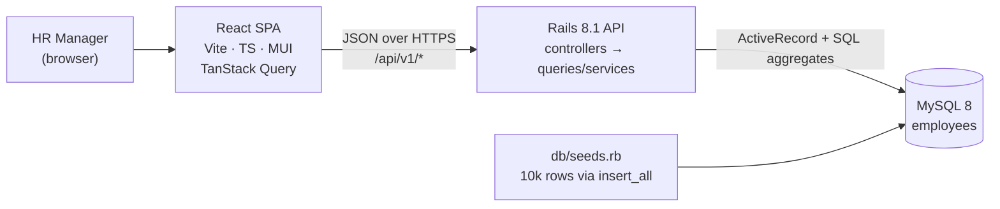
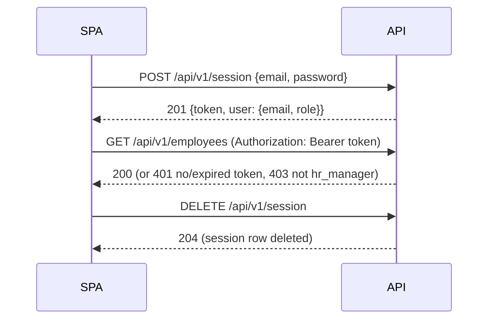

# Design & Trade-offs

## Architecture

- **SPA:** owns UI state only. Server state (lists, insights) lives in TanStack Query, keyed by every filter.
- **API:** thin controllers. Filtering is `Employees::SearchQuery`, aggregates are `Insights::SalaryStats`.
- **Dev:** Vite proxies `/api` to Rails, so dev is same-origin. **Prod:** two origins, with CORS limited to an allow-list.

## Data model

`employees`

| Column | Type | Notes |
|---|---|---|
| `full_name` | string, not null | search target |
| `email` | string, not null | **unique index**; format validated |
| `job_title` | string, not null | indexed |
| `department` | string, not null | indexed |
| `level` | string, not null | e.g. L1–L6 |
| `country` | string(2), not null | ISO 3166 code, from a fixed supported list; indexed |
| `currency` | string(3), not null | ISO 4217; **set from country**, not user input |
| `salary` | decimal(12,2), not null | annual gross, local currency, > 0 |
| `hire_date` | date, not null | not in the future |

**Indexes:** `email` (unique), `country`, `department`, `job_title`, and `[country, job_title]` for the
"job title within a country" question. Name search uses `LIKE 'term%'` on `full_name` / `email`, which can
use an index. A contains-search would need a full scan; at 10k rows that is still fast, so this is measured,
not guessed.

**Why currency is derived from the country:** this app allows exactly one currency per country. Letting HR
type both fields opens the door to "India / USD" rows that silently corrupt every per-country aggregate.

`users` / `sessions` (authentication)

| Table | Columns | Notes |
|---|---|---|
| `users` | `email` (unique), `password_digest`, `role` | `has_secure_password` (bcrypt). `role` is a Rails enum with one value today: `hr_manager`. |
| `sessions` | `user_id`, `token` (unique), `expires_at` | One row per sign-in, token from `has_secure_token`. Deleting the row signs out immediately. |

## Authentication & authorization

- **Bearer token, not cookies:** in production the SPA and API run on different origins. A token in the
  `Authorization` header avoids `SameSite=None` cookies and CSRF handling.
- **Server-side session rows** (not a stateless signed token), so sign-out and expiry really revoke access.
  The sessions expire after 12 hours.
- **Authorization** is one `before_action` in `Api::V1::BaseController`: `authenticate!` (401) followed by `require_hr_manager!` (403).
  There's no policy gem, because one role doesn't justify one.
- **Token storage in the SPA:** `localStorage`, so a page refresh keeps you signed in. The trade-off is XSS exposure.
  This is mitigated by React's escaping and by loading no third-party scripts. An httpOnly cookie on a shared domain would remove that risk, but it needs a custom domain.
- **Bootstrap user:** `db/seeds.rb` creates one HR Manager using `HR_MANAGER_EMAIL` / `HR_MANAGER_PASSWORD`, which come from env (with a dev-only default).

## API surface (`/api/v1`)

Everything except `POST /session` and `GET /up` requires `Authorization: Bearer <token>` and the `hr_manager` role.

| Method & path | Purpose |
|---|---|
| `POST /session` · `DELETE /session` · `GET /session` | Sign in (201 with token; 401 with a generic message on bad credentials) · sign out (204) · current user |
| `GET /employees?q=&country=&department=&job_title=&sort=&dir=&page=&per_page=` | Paginated, filtered list. `sort` is checked against an allow-list. Pagination metadata is in the body. |
| `GET /employees.csv?…same filters` | CSV export of the filtered set |
| `GET /employees/:id` · `POST /employees` · `PATCH /employees/:id` · `DELETE /employees/:id` | CRUD. Returns 201 / 200 / 204; 404 for an unknown id; 422 with `{ "errors": { field: [msg] } }` |
| `GET /filters` | Distinct countries, departments, job titles for the dropdowns |
| `GET /insights/countries` | Per country: headcount, min / median / avg / max in local currency, and median in USD |
| `GET /insights/job_titles?country=` | Same stats per job title, optionally within one country |

## Key algorithms

- **Median in MySQL 8** (no `PERCENTILE_CONT`): number the rows within each group with
  `ROW_NUMBER() OVER (PARTITION BY grp ORDER BY salary)` and count them with `COUNT(*) OVER (PARTITION BY grp)`.
  Keep the row(s) at positions `FLOOR((n+1)/2)` and `CEIL((n+1)/2)`, then `AVG` them. This handles odd and even group
  sizes in one query. It is covered by specs for odd, even, single-row and empty groups.
- **USD normalisation:** a static `config/exchange_rates.yml` (rate per currency, with an "as of" date).
  Conversion happens on aggregated values (`median × rate`), so each currency is only aggregated with itself.

## Deployment (local first, then hosted)

The whole system has to work locally end to end (MySQL, Rails, Vite, seeded data, sign-in) before any
hosting work begins. Railway is the current choice. Nothing in the code is tied to it (config comes only from env), so switching later costs nothing.

| Option | Cost | Trade-off |
|---|---|---|
| **Railway** (API + MySQL + static SPA) | Trial / hobby credit | One platform, managed MySQL, least setup. **Recommended.** |
| Render (free web + static) + Aiven/TiDB free MySQL | $0 | Two providers; free web service sleeps, so the first request takes 30–50 s |
| Fly.io (existing Dockerfile) + Aiven/TiDB MySQL | ~$0 | Most hands-on |

Production needs `DATABASE_URL`, `RAILS_MASTER_KEY`, `CORS_ORIGINS` (the SPA's URL) and `HR_MANAGER_EMAIL` / `HR_MANAGER_PASSWORD` on the API, and `VITE_API_URL` at SPA build time.

## Decisions
| Decision | Choice | Why | Alternative |
|---|---|---|---|
| Repo layout | Monorepo | One review link, one CI, shared docs | Two repos |
| Backend | Rails API-only | Owner's core strength | Full-stack Rails + Hotwire |
| Frontend | React + Vite + TS | Role asks for React | Hotwire/Turbo |
| Auth | `has_secure_password` + session rows + bearer token; single `hr_manager` role checked in one `before_action` | Persona is an HR Manager; revocable sessions; works across origins | Devise (heavy for one role); JWT (no real sign-out); cookies (cross-origin pain) |
| UI kit | MUI | Data grid, form controls and accessibility out of the box | shadcn/ui (more assembly) |
| Insights | SQL aggregates + window-function median | Avoid loading 10k rows; exact median | Ruby enumerables; approximate percentiles |
| Currency | Local currency stored; derived from country; USD view via static dated rates | Correct per-country stats + comparable cross-country view; no external dependency | Store USD only (loses the real salary); live FX API |
| Pagination | Offset (pagy) | Simple, supports "page N of M"; fine at 10k rows | Keyset (faster at millions, no page numbers) |
| Seeding | `insert_all` batches, seeded RNG | Speed + deterministic data | `create!` loop |
| Dev API access | Vite proxies `/api` → Rails (same origin) | No CORS needed locally | Call Rails directly with CORS in dev |
| CORS | Allow-list from `CORS_ORIGINS`, `/api/*` only; required in production (boot fails if unset) | Deployed SPA and API live on different origins; a silent localhost fallback would hide misconfiguration | `*` origins (too open) |
| Rails frameworks | Only ActiveRecord, ActionController, ActiveJob, ActionView loaded | API has no uploads, mail, rich text or websockets; smaller surface, faster boot | Default full stack |
