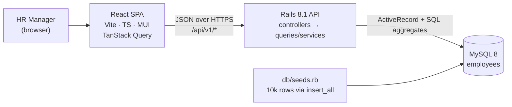
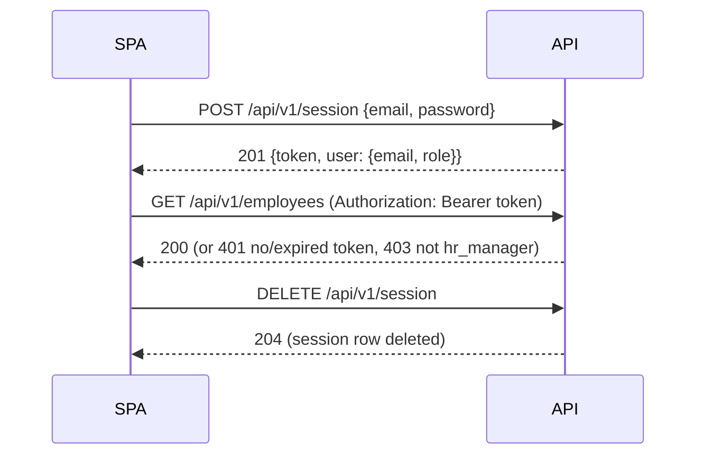

# Design & Trade-offs

## Architecture

- **SPA:** owns UI state only. Server state (lists, insights) lives in TanStack Query, keyed by every filter.
- **API:** thin controllers. Filtering is `Employees::SearchQuery`, aggregates are `Insights::SalaryStats`.
- **Dev:** Vite proxies `/api` to Rails, so dev is same-origin. **Prod:** two origins, with CORS limited to an allow-list.

## Data model

`employees`

| Column | Type | Notes |
|---|---|---|
| `full_name` | string, not null, ≤ 255 | searched (contains); indexed for the default name sort |
| `email` | string, not null | **unique index**; format validated |
| `job_title` | string, not null | indexed |
| `department` | string, not null | indexed |
| `level` | string(2), not null | one of L1–L6 (fixed list, `Employee::LEVELS`); not indexed: no level filter in scope |
| `country` | string(2), not null | ISO 3166 code from the supported list: AU, CA, DE, FR, GB, IN, SG, US |
| `currency` | string(3), not null | ISO 4217; **set from country**, not user input |
| `salary` | decimal(12,2), not null | annual gross, local currency; > 0 and < 10¹⁰ (column limit) |
| `hire_date` | date, not null | not in the future: compared with the UTC date + 1 day, so "today" works in every time zone without configuring one |

**Indexes:** `email` (unique; the case-insensitive collation also makes it case-insensitive), `full_name`, `department`, `job_title`, and
`[country, job_title]`, which serves both the country filter (its leftmost column) and the "job title within a country" question, so
`country` has no index of its own. Search is a **contains** match (`LIKE '%term%'`, wildcards in the term escaped), so "Silva" finds "Ana Silva". A prefix match can use an index but misses surnames. A contains match scans the table, which at 10k rows is still fast. This is checked with `EXPLAIN` and timing once the seeds exist (slice 6).

**Why currency is derived from the country:** this app allows exactly one currency per country. Letting HR
type both fields opens the door to "India / USD" rows that silently corrupt every per-country aggregate.

`users` / `sessions` (authentication)

| Table | Columns | Notes |
|---|---|---|
| `users` | `email` (unique), `password_digest`, `role` | `has_secure_password` (bcrypt). `role` is a Rails enum with one value today: `hr_manager`. `nil` means the account exists but has no access (403). |
| `sessions` | `user_id`, `token` (unique), `expires_at` | One row per sign-in, token from `has_secure_token`. Deleting the row signs out immediately. |

**Write paths that skip callbacks:** currency is set by a `before_validation` callback. `insert_all` (used by
the seeds) skips callbacks and validations, so the seeder sets `currency` from `Employee::CURRENCY_BY_COUNTRY.fetch(country)`
itself, and a spec checks that every seeded row's currency matches its country. No other code path uses `insert_all` or `update_column(s)`.

## Authentication & authorization

- **Bearer token, not cookies:** in production the SPA and API run on different origins. A token in the
  `Authorization` header avoids `SameSite=None` cookies and CSRF handling.
- **Server-side session rows** (not a stateless signed token), so sign-out and expiry really revoke access.
  Tokens are 24-char base58 (`has_secure_token`), matched case-sensitively (`utf8mb4_bin` column).
  The sessions expire after 12 hours (expired at exactly 12h). Expired rows are not deleted (harmless at this
  scale; a periodic `delete_all` on expired rows is the later fix).
- **Authorization** is one `before_action` in `Api::V1::BaseController`: `authenticate!` (401) followed by `require_hr_manager!` (403, added in slice 4 with its first consumer, the employees endpoints).
  There's no policy gem, because one role doesn't justify one.
- **Brute force:** `rate_limit` on sign-in (10 attempts / 3 minutes per IP). It uses the cache store, which is per process, so it is fine for a single instance. Tests use the null store, so the limit isn't exercised in specs.
- **Passwords:** at least 12 characters.
- **Token storage in the SPA:** `localStorage`, so a page refresh keeps you signed in. The trade-off is XSS exposure.
  This is mitigated by React's escaping and by loading no third-party scripts. An httpOnly cookie on a shared domain would remove that risk, but it needs a custom domain.
- **Signing out in the SPA:** a 401 clears the stored token (only if it is still the token that request sent), which
  redirects to sign-in. Sign out clears it at once and revokes the session in the background. Other tabs follow via
  the browser's `storage` event. Whenever the token goes away, the React Query cache is cleared, so no salary data outlives the session.
- **Bootstrap user:** `db/seeds.rb` creates one HR Manager using `HR_MANAGER_EMAIL` / `HR_MANAGER_PASSWORD`, which come from env (with a dev-only default).

## API surface (`/api/v1`)

Everything except `POST /session` and `GET /up` requires `Authorization: Bearer <token>`. From slice 4, every endpoint except `/session` also requires the `hr_manager` role.

**Employee JSON** has explicit fields (no timestamps): `id, full_name, email, job_title, department, level, country, currency, salary, hire_date`. `salary` is a **decimal string with two places** (`"1500000.00"`), exact for money, unlike a JSON number. The SPA types it as `string`.

**Errors** use one shape everywhere: `{ "errors": { field: [msgs] } }`, with `base` for errors not tied to a field (401: `{ "errors": { "base": ["Not signed in"] } }`).

| Method & path | Purpose |
|---|---|
| `POST /session` · `DELETE /session` · `GET /session` | Sign in (201 with token; 401 with a generic message on bad credentials) · sign out (204) · current user |
| `GET /employees?q=&country=&department=&job_title=&sort=&dir=&page=&limit=` | Paginated, filtered list: `{ employees: [...], meta: { page, limit, count, pages } }`. `limit` defaults to 25, max 100; a page past the end is empty. `q` is a case-insensitive contains-match on name or email. `sort` ∈ `full_name, salary, hire_date` (anything else falls back to `full_name`; **salary sort compares raw local amounts, so it is only meaningful within one country**, and the SPA offers it once a country is selected), `dir` ∈ `asc, desc`, ties broken by `id`. |
| `GET /employees.csv?…same filters` | CSV export of every matching row (pagination ignored). Salary has two decimals. Text cells starting with `= + - @`, tab or CR get a leading `'`, so spreadsheets don't run them as formulas (CSV injection). UTF-8 with a BOM, so Excel shows accented names correctly. Built from `pluck`, with no model objects, all in memory: fine at the ~10k-row scale. Above that, stream it. |
| `GET /employees/:id` · `POST /employees` · `PATCH /employees/:id` · `DELETE /employees/:id` | CRUD. Returns 201 / 200 / 204; 400 for a missing `employee` key or malformed JSON; 403 without the `hr_manager` role; 404 for an unknown id; 422 with `{ "errors": { field: [msg] } }` |
| `GET /filters` | Distinct departments and job titles in use, plus the **supported** countries and levels (from `Employee`), so the SPA never hard-codes those lists |
| `GET /insights?group=country\|job_title\|department&country=` | `{ group, rates_as_of, rows: [{ name, currency, headcount, min, median, avg, max, median_usd }] }`. Every row carries its currency, so the SPA handles one shape. **`group=country`**: each country in its own currency. **`job_title`/`department` with `country`** (any case): that country's currency. **Without `country`**: USD, with every salary converted *before* aggregating. An unsupported `group` or `country` returns 400 `{ errors: { group\|country: ["is not supported"] } }`. Answers requirements Q1–Q4 (Q3: headcount per country / department / job title). The key is `rows`, not a resource name, because a row is a statistics group, not a record. |

**Small groups:** a group of 1–2 people reveals their exact salaries through min/max. That's acceptable because only HR Managers, who can see every salary anyway, can call this. If insights ever reach a wider audience, suppress groups below ~5 people.

## Key algorithms

- **Median in MySQL 8** (no `PERCENTILE_CONT`): number the rows within each group with
  `ROW_NUMBER() OVER (PARTITION BY grp ORDER BY salary)` and count them with `COUNT(*) OVER (PARTITION BY grp)`.
  Keep the row(s) at positions `FLOOR((n+1)/2)` and `CEIL((n+1)/2)`, then `AVG` them. This handles odd and even group
  sizes in one query, together with min / avg / max (`Insights::SalaryStats`). It is covered by specs for odd, even,
  single-row and empty groups, and on the 10k seed every median matches a plain-Ruby recomputation (8/8 countries, 6/6 departments, 13/13 job titles).
- **USD normalisation:** fixed, *illustrative* rates in code (`Insights::SalaryStats::USD_PER_UNIT`, `RATES_AS_OF`),
  not live market data, so figures are stable. The date is returned to the SPA for display.
  - Per country there is one currency, so the median can be converted *after* aggregating (`median × rate`).
  - Job titles span currencies, so each salary is converted *before* aggregating. Currencies are never mixed.
  - Rates enter the SQL as `CAST(? AS DECIMAL(12, 6))`. A quoted rate made MySQL fall back to `DOUBLE`, verified: it
    returned a `Float`. The CAST keeps the arithmetic in exact `DECIMAL`.

## Seeding & performance (measured, 10,000 employees, local MySQL 8)

**Seeding:** `bin/rails db:seed` runs `Employees::Seeder`.
- **Deterministic:** a fixed `Random` seed, so every run produces the same data.
- **Names:** first and last names from `db/seeds/*.txt` (~100 each, including accented names). Emails are transliterated to ASCII and given a number suffix, so they're unique.
- **Distribution:** countries and levels are weighted. Salary = the country's L3 pay band × a level multiplier (0.6–2.2) × a job-title factor (0.7–1.15) × a ±15% spread, so pay differs by country, level *and* role.
- **Writes:** `insert_all!` in batches of 1,000 inside **one transaction** (a failed run leaves no partial table), with currency set explicitly.
- **Speed:** **1.2 s** for 10k rows. The first version took 10.8 s because `Range#count` on dates was called once per row; the span is now precomputed.
- **Idempotent:** employees are only inserted into an empty table, and the HR Manager is created only if missing. The dev login defaults apply **only in development/test**; every other environment must set `HR_MANAGER_EMAIL` / `HR_MANAGER_PASSWORD`.

Averages of 10 runs with Active Record's query cache **off**. An earlier version of this table was measured with it on, which made the numbers 2–4× too optimistic.

| Query | Time | Plan (`EXPLAIN`) |
|---|---|---|
| List page 1, default name sort | 2.9 ms | `index_employees_on_full_name`, reads 25 rows |
| `count` for pagination meta | 2.2 ms | |
| Search `q=silva` + count (contains, `LIKE '%…%'`) | 7.6 ms | walks the name index with a filter; no full sort |
| `country=IN`, sort by salary | 3.7 ms | |
| `department` + `job_title` | 2.4 ms | index-merge intersect of both indexes |
| `/filters` (2 × `DISTINCT`) | 2.6 ms | |
| CSV export, all 10k rows | ~535 ms | `pluck` 78 ms, CSV build 50 ms, **money formatting 407 ms** |
| `/insights?group=country` | 28 ms | one pass with window functions |
| `/insights?group=department&country=IN` | 8 ms | |
| `/insights?group=job_title` (USD per row) | 39 ms | |

**Conclusion:** every interactive query is far below the 300 ms target, so the contains-search scan needs no full-text index at
this scale. The CSV cost is dominated by `number_to_rounded` (exact BigDecimal formatting). Half a second is acceptable
for a download, and hand-rolled formatting would be about 4× faster but is more code to trust. Revisit only if exports grow.

## Deployment (local first, then hosted)

The whole system has to work locally end to end (MySQL, Rails, Vite, seeded data, sign-in) before any
hosting work begins. Railway is the current choice. Nothing in the code is tied to it (config comes only from env), so switching later costs nothing.

| Option | Cost | Trade-off |
|---|---|---|
| **Railway** (API + MySQL + static SPA) | Trial / hobby credit | One platform, managed MySQL, least setup. **Recommended.** |
| Render (free web + static) + Aiven/TiDB free MySQL | $0 | Two providers; free web service sleeps, so the first request takes 30–50 s |
| Fly.io (existing Dockerfile) + Aiven/TiDB MySQL | ~$0 | Most hands-on |

Before going live (slice 13): `VITE_API_URL` must be `https://` (the bearer token and password travel in it),
and the SPA host should send a Content-Security-Policy (`script-src 'self'`, `connect-src` the API) to enforce the
"no third-party scripts" assumption behind the localStorage token.

Production needs `DATABASE_URL`, `RAILS_MASTER_KEY`, `CORS_ORIGINS` (the SPA's URL) and `HR_MANAGER_EMAIL` / `HR_MANAGER_PASSWORD` on the API, and `VITE_API_URL` at SPA build time.

## Decisions
| Decision | Choice | Why | Alternative |
|---|---|---|---|
| Repo layout | Monorepo | One review link, one CI, shared docs | Two repos |
| Backend | Rails API-only | Owner's core strength | Full-stack Rails + Hotwire |
| Frontend | React + Vite + TS | Role asks for React | Hotwire/Turbo |
| Auth | `has_secure_password` + session rows + bearer token; single `hr_manager` role checked in one `before_action` | Persona is an HR Manager; revocable sessions; works across origins | Devise (heavy for one role); JWT (no real sign-out); cookies (cross-origin pain) |
| UI kit | MUI | Data grid, form controls and accessibility out of the box | shadcn/ui (more assembly) |
| Insights | SQL aggregates + window-function median | Avoid loading 10k rows; exact median | Ruby enumerables; approximate percentiles |
| Currency | Local currency stored; derived from country; USD view via static dated rates | Correct per-country stats + comparable cross-country view; no external dependency | Store USD only (loses the real salary); live FX API |
| Pagination | Offset (pagy) | Simple, supports "page N of M"; fine at 10k rows | Keyset (faster at millions, no page numbers) |
| Seeding | `insert_all` batches, seeded RNG | Speed + deterministic data | `create!` loop |
| Dev API access | Vite proxies `/api` → Rails (same origin) | No CORS needed locally | Call Rails directly with CORS in dev |
| CORS | Allow-list from `CORS_ORIGINS`, `/api/*` only; required in production (boot fails if unset) | Deployed SPA and API live on different origins; a silent localhost fallback would hide misconfiguration | `*` origins (too open) |
| Rails frameworks | Only ActiveRecord, ActionController, ActiveJob, ActionView loaded | API has no uploads, mail, rich text or websockets; smaller surface, faster boot | Default full stack |
